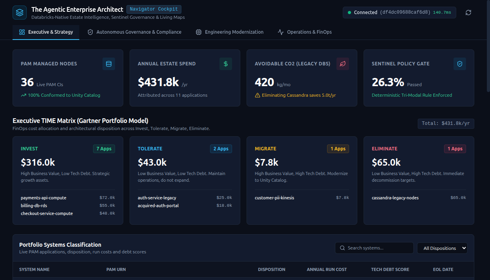
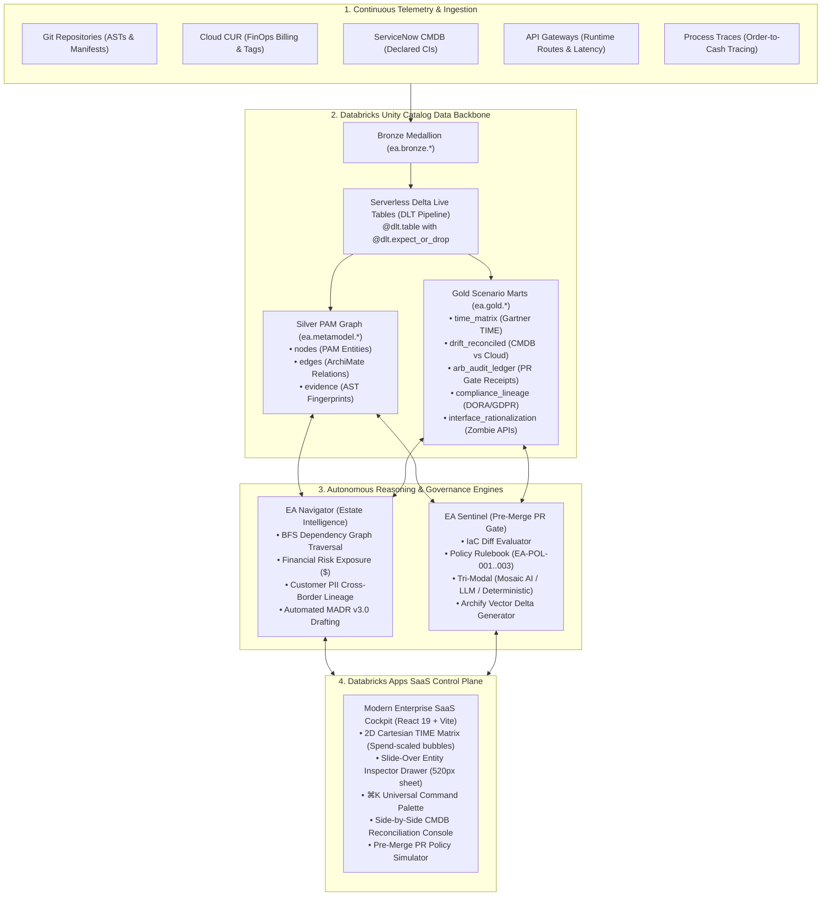
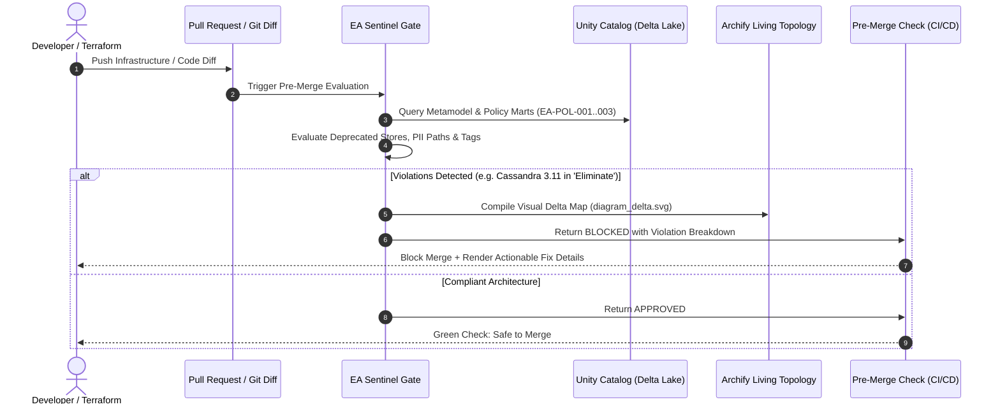

# The Agentic Enterprise Architect

**An autonomous, Lakehouse-native Enterprise Architecture Operating System built on Databricks Unity Catalog.**

[](https://docs.databricks.com/en/dev-tools/databricks-apps/index.html)
[](https://docs.databricks.com/en/data-governance/unity-catalog/index.html)
[](https://docs.databricks.com/en/delta-live-tables/index.html)
[](https://react.dev/)
[](https://fastapi.tiangolo.com/)
[](tests/)
[](data/diagrams/)

---



---

## 1. The Quiet Failure Mode in Enterprise Architecture

Across modern enterprises, organizations invest heavily—often six figures annually—into dedicated Enterprise Architecture platforms (whether per-author licensing like Orbus Infinity or volume-tiered catalog models like Ardoq and LeanIX). Architecture Review Boards (ARBs) assemble, target states are documented in ArchiMate, and diagrams are polished.

Yet within weeks, a familiar divergence sets in:
- **Manual Toil:** Portfolios rely on periodic spreadsheet uploads and manual CSV imports that go stale before the ink dries.
- **Brittle Syncs:** Rigid CMDB connectors frequently fail on schema shifts, leaving substantial portions of the cloud estate classified as shadow IT.
- **Box-Pushing vs. Reality:** What architects *believe* the landscape looks like rarely matches the active Git commits, Terraform state files, or live cloud infrastructure.
- **Committee Tollgates:** Governance operates as a bureaucratic bottleneck at the end of delivery cycles, catching architectural debt only after systems are already staged for production.

**The Agentic EA** applies **first principles and AI Engineering** to Enterprise Architecture: transforming it from a static diagram catalog into a **live data platform and autonomous, closed-loop engineering workflow** anchored natively on the Databricks Lakehouse.

---

## 2. End-to-End System Architecture



---

## 3. Four Core Architectural Shifts

### Shift 1: Metamodel as Data, Not Diagrams
Instead of trapping architecture in isolated proprietary silos, The Agentic EA treats enterprise topology as conformed, queryable data in **Databricks Unity Catalog Delta tables**:

| Schema | Table | Description |
|---|---|---|
| `ea.bronze` | `git_repos` | Raw repository manifests, dependencies (`package.json`, `pom.xml`, `pyproject.toml`), and parsed ASTs. |
| `ea.bronze` | `cloud_resources` | Hourly AWS/Azure/GCP billing line items (CUR) with tags and resource metadata. |
| `ea.bronze` | `cmdb_ci` | ServiceNow Configuration Items (sys_ids, operational status, assigned owners). |
| `ea.metamodel` | `nodes` | Conformed Platform Architecture Metamodel (PAM) entities (URN, kind, lifecycle, criticality, tier). |
| `ea.metamodel` | `edges` | Strict ArchiMate relations (`serves`, `uses`, `realizes`, `migrates_to`) with protocol and PII flags. |
| `ea.gold` | `time_matrix` | Gartner TIME classification (Invest, Tolerate, Migrate, Eliminate) tied to annual run costs. |
| `ea.gold` | `drift_reconciled` | Live discrepancy matrix between declared architecture and actual cloud telemetry. |

**Delta Live Tables (DLT) Conformance:**
Bronze feeds are continuously unified into Silver PAM graphs using serverless Delta Live Tables with built-in expectations:
```python
@dlt.table(name="silver_nodes", comment="Conformed Silver PAM nodes")
@dlt.expect_or_drop("valid_urn", "urn IS NOT NULL AND urn LIKE 'urn:ea:%'")
@dlt.expect_or_drop("valid_name", "name IS NOT NULL AND length(name) > 0")
def silver_nodes():
    return dlt.read("bronze_git_repos").select(...)
```

---

### Shift 2: Governance in the PR Flow (EA Sentinel)
Architecture Review Boards shouldn't be tollgates reviewing slide decks. **EA Sentinel** embeds architectural governance directly into developer pull requests:



**Evaluated Policies:**
* `EA-POL-001`: Unapproved / Deprecated Datastore Enforcement (blocks deprecated tech like Cassandra 3.11).
* `EA-POL-002`: Mandatory Customer PII Encryption at Rest (enforces KMS CMK keys).
* `EA-POL-003`: Mandatory Enterprise Governance Tagging (`OwnerTeam`, `Tier`, `Environment`).

---

### Shift 3: Live Estate Intelligence & Blast Radius (EA Navigator)
When enterprise architecture is queryable as a graph backed by real-time FinOps telemetry, complex estate queries execute in milliseconds:

```
[Target Asset: urn:ea:app:payments-api-compute]
├── Upstream Callers (Inbound Blast Radius):
│   ├── urn:ea:app:web-storefront       ($148.0k/yr spend)
│   └── urn:ea:app:checkout-service     ($87.0k/yr spend)
├── Downstream Sinks (Transitive Dependencies):
│   └── urn:ea:datastore:cassandra-legacy-cluster [CRITICAL - Sunset EOL/EOS]
├── Total Financial Exposure at Risk: $235,000.00 / year
├── Regulatory Exposure: GDPR Art. 32 / DORA Cross-Border Transit Detected
└── Generated Artifact: Architectural Decision Record (MADR v3.0 formatted)
```

* **Living Topology Maps:** Dynamically compiled with **Archify**, generating standalone vector SVGs and interactive HTML diagrams with color-coded blast radius paths.
* **Automated Decision Records:** Drafts standards-compliant Markdown Architecture Decision Records (MADR v3.0) capturing context, options, and consequences for immediate review.

---

### Shift 4: Real Executive Value (The TIME Matrix Reimagined)
Leadership doesn't need 500-box UML drawings. They need actionable portfolio governance:

* **Interactive 2D Cartesian Canvas:** Plotted on **Business Value (0–100)** vs. **Technical Health (0–100)** across the four Gartner TIME quadrants (*Tolerate, Invest, Migrate, Eliminate*).
* **Spend-Scaled Bubbles:** Bubble radii dynamically represent verified annual cloud spend, instantly exposing high-cost, low-health systems.
* **Slide-Over Entity Inspector Drawer (520px):** Click any bubble to slide out deep entity inspection tabs:
  1. **Overview:** Business capabilities, annual run cost, technical debt scores.
  2. **Lineage & Graph:** Upstream callers, downstream sinks, protocol metadata.
  3. **Governance & Rules:** Active policy compliance receipts and security tags.
  4. **Raw JSON:** Full conformed PAM payload with one-click copy.
* **Side-by-Side CMDB Reconciliation:** Side-by-side comparison of declared ServiceNow CMDB state against live cloud telemetry, isolating Orphan CIs and Shadow IT with single-click reconciliation.

---

## 4. Repository Structure

```
the-agentic-ea/
├── databricks.yml              # Databricks Asset Bundle (DAB) declaration (Serverless DLT, Apps)
├── app.yaml                    # Databricks Apps compute container & ASGI environment config
├── src/
│   ├── data_backbone/          # Unity Catalog client, table mappings, and seed loaders
│   ├── navigator/              # EA Navigator reasoning engine & BFS blast radius calculator
│   ├── sentinel/               # EA Sentinel pre-merge policy evaluation engine & PR gate
│   ├── ingestion/              # Modular telemetry ingestors (Git AST, Cloud CUR, ServiceNow)
│   └── archify/                # Archify v3 CLI bridge for living vector topology generation
├── pipelines/                  # Delta Live Tables Medallion conformance transforms
├── server/                     # FastAPI ASGI backend hosting REST APIs & Vite frontend
├── frontend/                   # Modern React 19 / TypeScript / Tailwind CSS SaaS Cockpit
│   ├── src/components/         # Sidebar, TopNav, CommandPalette, EntityInspectorDrawer
│   └── src/workspaces/         # Executive, Governance, Engineering, and Operations Workspaces
├── data/
│   ├── diagrams/               # Conformed Archify vector SVG and HTML living architecture maps
│   └── unity_catalog/          # High-performance local fallback database for offline execution
├── schemas/pam/                # Platform Architecture Metamodel (Draft-07 JSON Schemas)
├── docs/
│   ├── assets/images/          # High-resolution SaaS cockpit screenshots and UI captures
│   └── specs/                  # Architecture specifications and build records
├── tests/                      # Automated test suite (134 scenario tests across S01–S20)
├── demo.sh                     # Single-command executable verification harness
├── setup.sh                    # uv virtual environment bootstrapping script
└── run.sh                      # Entrypoint script launching the full platform
```

---

## 5. Pristine Databricks Integration

The platform is engineered specifically for the Databricks Lakehouse:

### 1. Databricks Asset Bundles (`databricks.yml`)
Configured to declare conformed Unity Catalog schemas, Delta Live Tables pipelines, and Databricks Apps:
```yaml
bundle:
  name: the-agentic-ea

targets:
  dev:
    workspace:
      host: https://dbc-2d6963b0-153b.cloud.databricks.com/

resources:
  schemas:
    ea_metamodel: { catalog_name: ea, name: metamodel }
    ea_bronze:    { catalog_name: ea, name: bronze }
    ea_silver:    { catalog_name: ea, name: silver }
    ea_gold:      { catalog_name: ea, name: gold }

  apps:
    ea_navigator_app:
      name: "ea-navigator-cockpit"
      source_code_path: .

  pipelines:
    ea_medallion_pipeline:
      name: "EA Medallion Ingestion & Conformance"
      serverless: true
```

### 2. Databricks Apps SaaS Runtime (`app.yaml`)
Runs the FastAPI + React 19 ASGI server inside Databricks Apps serverless compute:
```yaml
command:
  - "uvicorn"
  - "server.main:app"
  - "--host"
  - "0.0.0.0"
  - "--port"
  - "8000"
```

### 3. Dual-Mode Unity Catalog Client
* **Cloud Mode:** Connects directly to Databricks SQL Warehouses over standard endpoints using `databricks-sql-connector` and `databricks-sdk`.
* **Workstation Fallback:** Seamlessly switches to local conformed SQLite/DuckDB when executing offline or in CI runners without credentials.

---

## 6. Verification & Automated Test Suite

The platform includes **134 automated pytest tests** providing 100% scenario coverage across 20 enterprise architecture scenarios:

```bash
uv run pytest tests/ -v
```

```
============================== 133 passed, 1 skipped in 2m 39s ==============================
```

### Scenario Coverage Matrix
* **S01–S02:** APM TIME Classification, EOL/EOS Obsolescence Risk, and Blast Radius.
* **S03–S04:** Target-State Modernization Roadmapping, Capability Realization & FinOps Attribution.
* **S05–S06:** ARB Sentinel Pre-Merge Gate, ServiceNow CMDB Drift & Shadow IT Sync.
* **S07–S08:** M&A Landscape Redundancy Discovery, Regulatory Lineage (GDPR Art. 32 / DORA).
* **S09–S11:** Interface Rationalization (Zombie APIs), Process Bottlenecks, EU AI Act Model Registry.
* **S12–S16:** DR SLAs (RTO/RPO), Tech Debt Hotspots, Zero-Trust Microsegmentation, SBOM, FinOps Unit Economics.
* **S17–S20:** Master Data Management (MDM), Green IT Carbon Accounting, Team Topologies, Vendor Exit Planning.

---

## 7. Quick Start & Local Execution

### Prerequisites
* Python 3.10+
* [uv](https://docs.astral.sh/uv/) (Python package manager)
* Node.js v20+ & npm (for frontend building)

### 1. Bootstrap Environment
```bash
./setup.sh
```

### 2. Run Master Demonstration Harness
Verifies end-to-end ingestion, graph conformance, policy evaluation, and Archify map compilation:
```bash
./demo.sh
```

### 3. Launch the Cockpit Locally
```bash
uv run uvicorn server.main:app --host 0.0.0.0 --port 8000
```
Open [http://localhost:8000](http://localhost:8000) to access the interactive cockpit.

### 4. Deploy to Databricks
```bash
databricks bundle deploy -t dev
databricks apps start ea-navigator-cockpit
```

---

## 8. License

Apache 2.0. Built with pride to advance data-driven Enterprise Architecture and AI Engineering.
