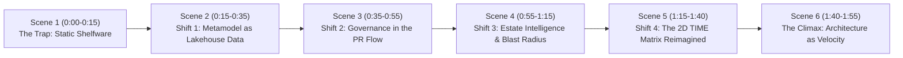

# The Agentic EA — Master Video Director's Specification & Storyboard
**Target Deliverable:** 90–120 Second Technical Product Launch Video (1080p MP4, 60fps)  
**Companion Piece to:** LinkedIn Thought Leadership Post ("Confusing the Diagram with the System")  
**Target Audience:** Enterprise Architects, CTOs, VP Engineering, Platform/Data Engineers, Databricks Community  
**Production Standard:** Stripe / Linear / Datadog caliber; dark aesthetic (`#080c14`), 0 emojis, high velocity.  
**CRITICAL DIRECTIVE ON AUDIO & TEXT:**
- **NO VOICE NARRATION.** Do NOT use speech/voiceover audio.
- **MUST BE SUBTITLED:** All narrative text from the LinkedIn post must be presented as **crisp, burned-in subtitles / kinetic typography / sleek lower-thirds / caption ribbons** perfectly synchronized with the on-screen action.
- **AUDIO BED:** Silent, or optional subtle low-volume ambient techno/synth pulse. Zero spoken voice.
- **REAL VIDEO ONLY:** Must be genuine video motion (live screencasts/recordings of UI interactions, clicks, typing, drawer sliding in, 2D canvas hover tooltips, PR evaluation, terminal output scrolling, Databricks UC, DLT), **NOT static screenshots or a slideshow of stills**.

---

## 1. Executive Vision & Creative Concept

The LinkedIn post confronts the traditional failure mode of Enterprise Architecture: spending $100k+ on passive diagramming tools (Ardoq, LeanIX, Orbus) while runtime cloud infrastructure drifts silently. 

This video is **not** a generic slide presentation. It is a **live, high-density engineering showcase** demonstrating the closed loop:
1. **Live Data Ingestion & Unity Catalog Backbone** (Delta Lake, Connectors, DLT).
2. **Autonomous Pre-Merge Policy Enforcement** (EA Sentinel PR gate with visual diffs).
3. **Real-time Graph Blast Radius** (Sub-second BFS traversal & regulatory PII tracing).
4. **Interactive Modern SaaS UI** (2D Cartesian TIME Matrix, Slide-over Entity Inspector, Command Palette `⌘K`).

---

## 2. Scene-by-Scene Storyboard & Narrative Mapping

### Scene 1: The Trap — Confusing the Diagram with the System (0:00 – 0:15)
- **LinkedIn Voiceover/Text Overlay:**
  > *"There’s a quiet failure mode in Enterprise Architecture: confusing the diagram with the system. While teams spend six figures on passive diagram catalogs, cloud infrastructure silently drifts."*
- **Visuals in Motion:**
  - Fast montage / split-second glimpse of traditional static box-and-line diagrams fading into the background.
  - Glitch effect or drift indicator showing discrepancies accumulating between static docs and real code.
  - Hard transition cut into terminal showing Databricks workspace CLI and live telemetry streaming.
- **Lower Third / Badge:** `THE FAILURE MODE: STATIC ARCHITECTURE SHELFWARE`

---

### Scene 2: Shift 1 — Metamodel as Data, Not Diagrams (0:15 – 0:35)
- **LinkedIn Voiceover/Text Overlay:**
  > *"Shift 1: Metamodel as Data, Not Diagrams. Instead of an isolated SaaS silo, architecture lives directly on the Lakehouse. Git ASTs, Cloud CUR billing, and CMDB records stream into conformed Medallion Delta tables in Databricks Unity Catalog."*
- **Visuals in Motion:**
  - **Databricks Unity Catalog UI / CLI:** Pan across `ea` catalog schemas (`ea.metamodel`, `ea.bronze`, `ea.silver`, `ea.gold`).
  - Show the 27 conformed Delta tables (`ea.metamodel.nodes`, `ea.metamodel.edges`, `ea.gold.time_matrix`).
  - **Delta Live Tables (DLT) Pipeline:** Capture the active DLT pipeline DAG `EA Medallion Ingestion & Conformance` running serverless compute, validating bronze expectations, and materializing the PAM graph in silver.
  - **Modular Connectors in action:** Quick visual cuts of the ingestion connectors (GitHub Org AST extractor, AWS Cloud CUR FinOps, ServiceNow CMDB Table API, and Backstage sync).
- **Lower Third / Badge:** `DATABRICKS UNITY CATALOG + DELTA LIVE TABLES (PAM METAMODEL)`

---

### Scene 3: Shift 2 — Governance in the PR Flow (0:35 – 0:55)
- **LinkedIn Voiceover/Text Overlay:**
  > *"Shift 2: Governance in the PR Flow. If architecture only gets evaluated at a monthly committee meeting, it's already too late. Autonomous pre-merge AI gates evaluate infrastructure diffs before code merges."*
- **Visuals in Motion:**
  - **GitHub / Terminal Pull Request:** A developer submits a Terraform/IaC PR introducing a deprecated Cassandra 3.11 datastore with unencrypted PII.
  - **EA Sentinel Gate Trigger:** Pre-merge gate executes in seconds.
  - **Databricks App Cockpit (Governance Workspace):**
    - Show the **Pre-Merge PR Policy Simulator** in the live SaaS app.
    - Click "Simulate Evaluation": API responds with crisp red `BLOCKED` pill.
    - Policy violation breakdown: `EA-POL-001` (Cassandra in 'Eliminate'), `EA-POL-002` (Unencrypted PII), `EA-POL-003` (Missing tags).
    - Reveal the **Archify Visual Delta Diff**: Interactive vector diagram with deprecated node highlighted in glowing rose red.
- **Lower Third / Badge:** `AUTONOMOUS PRE-MERGE POLICY GATE (EA SENTINEL)`

---

### Scene 4: Shift 3 — Live Estate Intelligence & Blast Radius (0:55 – 1:15)
- **LinkedIn Voiceover/Text Overlay:**
  > *"Shift 3: Live Estate Intelligence & Blast Radius. Answering 'What is our financial exposure if this service is sunset?' or 'Where does PII cross DORA boundaries?' isn't a 4-week consulting engagement. It's a graph traversal computed in milliseconds."*
- **Visuals in Motion:**
  - **Living Architecture Maps:** Pan across full-screen Archify interactive vector map (`architecture-view.svg`), demonstrating smooth pan/zoom and crisp boundary clusters (Core Application Mesh, Secure Data Vault).
  - **BFS Graph Traversal in Action:** Trigger blast radius analysis on `payments-api-compute`.
  - Upstream callers highlighted dynamically; dollar exposure calculated instantly ($234,999.84/yr at risk).
  - PII compliance lineage map (`gdpr_dora_lineage.svg`): tracing unencrypted cross-border transit between EU-West-1 and US-East-1.
- **Lower Third / Badge:** `ESTATE INTELLIGENCE ENGINE: SUB-SECOND BLAST RADIUS & MADR DRAFTING`

---

### Scene 5: Shift 4 — Real Executive Value: The 2D TIME Matrix Reimagined (1:15 – 1:40)
- **LinkedIn Voiceover/Text Overlay:**
  > *"Shift 4: Real Executive Value. Leadership doesn't need 500-box UML drawings. They need actionable portfolio governance: an interactive 2D TIME matrix plotted on business value versus technical debt, tied to live cloud run costs."*
- **Visuals in Motion:**
  - **Databricks App Live Navigation (Linear/Datadog Caliber):**
    - High-contrast dark theme (`#080c14` canvas, `#0d1322` collapsible sidebar).
    - TopNav: Breadcrumb navigation and live warehouse ping (`df4dc09688caf6d8 • 120ms`).
    - **Global Command Palette (`⌘K`):** Hit shortcut, type `cassandra`, instant fuzzy matching across applications and PAM nodes.
    - **2D Cartesian Canvas:** The 4 Gartner quadrants (Tolerate, Invest, Migrate, Eliminate) plotted with glowing, spend-scaled bubbles.
    - **Deep Slide-Over Entity Inspector Drawer (`w-[520px]`):** Click `payments-api-compute` bubble. Smooth slide-over drawer animates from right.
    - Cycle through drawer tabs: *Overview* (annual spend, tech debt score), *Lineage & Graph*, *Governance & Rules*, and *Raw JSON* with 1-click copy.
    - **Operations Workspace:** Side-by-side ServiceNow CMDB vs live cloud runtime telemetry, 1-click reconciliation stepper.
- **Lower Third / Badge:** `THE RE-ENGINEERED 2D CARTESIAN TIME MATRIX & SLIDE-OVER INSPECTOR`

---

### Scene 6: The Payoff — Architecture as Engineering Velocity (1:40 – 1:55)
- **LinkedIn Voiceover/Text Overlay:**
  > *"When architecture runs as code and live data, it stops being shelfware—and starts actively accelerating engineering velocity. Closing the loop between executive strategy and raw commit diffs."*
- **Visuals in Motion:**
  - High-velocity summary montage: Git commit diff ➔ Unity Catalog Delta table ➔ DLT Pipeline ➔ Sentinel Gate ➔ 2D Cockpit UI.
  - Final Hero Card:
    - **The Agentic Enterprise Architecture Platform**
    - *Databricks Unity Catalog • Delta Live Tables • Archify • Modern SaaS Cockpit*
    - GitHub Repo link & live Databricks App URL.
- **Lower Third / Badge:** `THE AGENTIC EA: CLOSED-LOOP ENTERPRISE GOVERNANCE`

---

## 3. Technical Execution Instructions for the Builder Agent (`wV:pK`)

The builder agent in pane `wV:pK` is directed to construct the video using either **Remotion** (React-based code-to-video) or **Headless Chrome capture + FFmpeg assembly**:

### Option A (Recommended): Browser Automation Capture + FFmpeg Composition
1. **Automated Screen Capture Sequence:**
   - Launch Playwright or Chrome via OpenCLI at 1920x1080 resolution targeting `https://ea-navigator-cockpit-3671477545521222.aws.databricksapps.com`.
   - Script smooth interactions:
     - Navigation between Sidebar workspaces (Executive -> Governance -> Engineering -> Operations).
     - Hover over 2D TIME Matrix bubbles with tooltips.
     - Click bubble to trigger smooth 520px Slide-Over Entity Inspector Drawer.
     - Trigger `⌘K` Command Palette, type query, select result.
     - Governance workspace: click "Simulate Evaluation" to show real-time `BLOCKED` receipt.
     - Operations workspace: cycle through CMDB drift items.
   - Record video stream directly or capture sequential high-fps frame sequence.
2. **Databricks Backend Screen Capture:**
   - Record terminal or browser view of Databricks CLI / Catalog commands (`databricks schemas list ea`, `databricks pipelines list-pipelines`).
3. **FFmpeg Assembly & Polish:**
   - Stitch clips into 1080p MP4 with 60fps.
   - Overlay sleek semi-transparent dark lower-thirds and scene headers matching the Linear dark palette (`#0d1322` bg, `#38bdf8` accent, pure white text).
   - Export final video to `data/video/the_agentic_ea_launch.mp4`.
