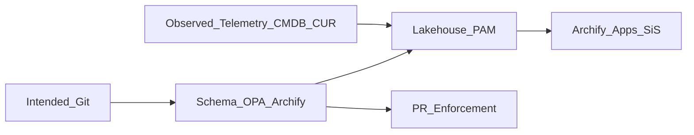

# 2.1 — From repository EA to agent-native EA

## The old paradigm

Orbus Infinity assumes architecture truth is **curated in a repository** and periodically synchronized from enterprise systems. Humans (EA teams) are the primary authors; delivery teams are consumers or reluctant updaters.

## The new paradigm

Agent-native EA assumes:

1. **Intended architecture** is authored next to code (ADRs, IaC, OpenAPI, capability YAML).
2. **Observed architecture** is continuously ingested into a lakehouse.
3. **Agents** reconcile, propose, and often remediate via PRs.
4. **Diagrams are compiled** (e.g., Archify `finalize`) with validation gates—not pasted screenshots.
5. **Orbus** (if retained) becomes a stakeholder portal or interim store—not the sole metamodel authority.

## What changes for architects

| Old job | New job |
|---|---|
| Draw and maintain diagrams | Define metamodel contracts and quality gates |
| Chase updates after projects | Instrument intended+observed pipelines |
| Host ARB meetings with decks | Host ARB with PR diffs + policy failures |
| Own the tool | Own the semantic graph and decision quality |

## Citations

- [@archify-github]
- [@opa-conftest]
- [@wcid-agy-research]

## Chapter validation checklist

| Check | Status |
|---|---|
| Baseline fidelity | PASS |
| Modern option completeness | PASS |
| API hygiene | PASS |
| Archify accuracy | PASS |
| Internal consistency | PASS |
| Citations present | PASS |
| TOC linkage | PASS |
| Editorial (Orbus spelling) | PASS |

**Validation status:** PASS

