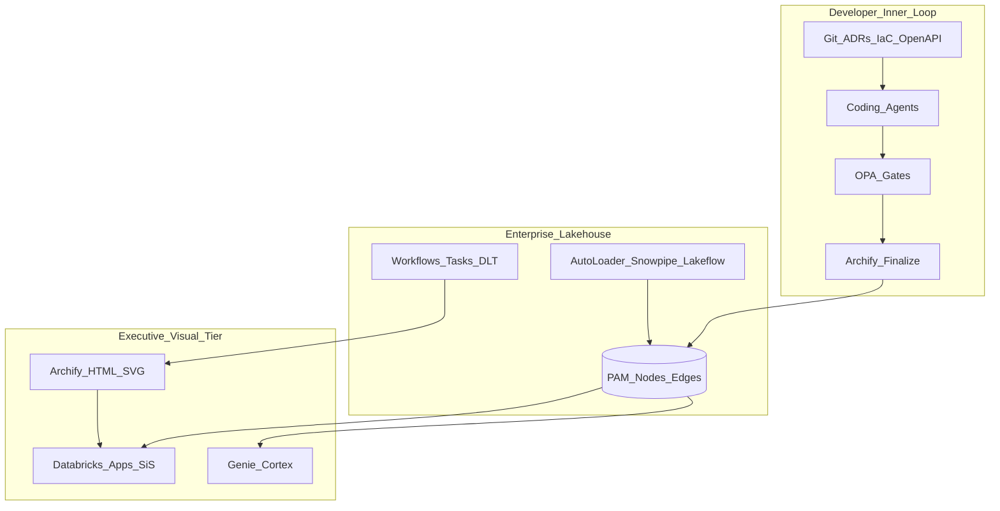

# 3.1 — ANEA topology (intended vs observed)

**ANEA** = Agent-Native Enterprise Architecture.

## Topology

## Dual-truth plane

| Plane | Sources | Failure if ignored |
|---|---|---|
| **Intended** | ADR, Terraform/Pulumi, OpenAPI, capability YAML, CODEOWNERS | Shadow architecture |
| **Observed** | CMDB CDC, CUR, VPC flow, OTel, MLflow, SBOM JSON | Comforting fiction |

Orbus Infinity primarily stores **declared** objects with connector assists. ANEA makes the dual plane explicit.

## Citations

- [@archify-github]
- [@databricks-autoloader]
- [@snowflake-snowpipe]
- [@wcid-agy-research]

## Chapter validation checklist

| Check | Status |
|---|---|
| Baseline fidelity | PASS |
| Modern option completeness | PASS |
| API hygiene | PASS |
| Archify accuracy | PASS |
| Internal consistency | PASS |
| Citations present | PASS |
| TOC linkage | PASS |
| Editorial (Orbus spelling) | PASS |

**Validation status:** PASS

