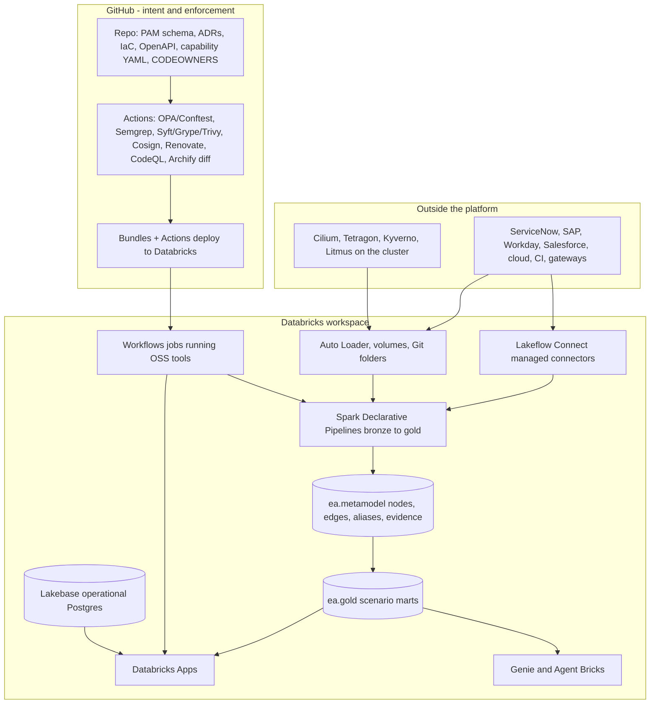

# 8.2 — Databricks-hosted reference solution (C1–C15, S01–S20)

**Status:** solution v1 · **Date:** 2026-10-13 · **Scope:** one buildable solution that replaces Orbus Infinity across all fifteen canonical capabilities and runs all twenty scenarios, hosted on **Databricks**, with **GitHub** carrying intent and enforcement.

Licensed components used: **GitHub** and **Databricks** only. Every other component is free/open-source and is hosted *inside* Databricks as a notebook, job, or app, per the hosting rules in [§5](01-licence-clean-ranked-options.md#5-hosting-what-runs-inside-snowflake-and-databricks). Nothing in this design requires a third paid product.

---

## 1. Solution in one picture

One workspace per environment (dev, prod), Unity Catalog enabled, serverless compute enabled. The reference point for every entity is the PAM URN in `ea.metamodel`, so all twenty scenarios share one identity model.

---

## 2. Unity Catalog layout

| Object | Purpose |
|---|---|
| `ea.metamodel.nodes`, `.edges`, `.aliases`, `.evidence` | The open CoreEA equivalent. One row per entity; edges use the closed ArchiMate-aligned relation enum; `aliases` map CMDB sys_id, ARN, repo URL and billing tag to a URN; `evidence` records source, confidence and pointer |
| `ea.metamodel.standards`, `.adrs`, `.exceptions` | Standards library, decision records, approved deviations (C2, C11) |
| `ea.bronze.*` | Raw landed sources — CMDB, cost, SBOM, flow logs, gateway logs, Git metadata, contracts, carbon, model events |
| `ea.silver.*` | Conformed entities — applications, services, APIs, infrastructure nodes, data entities, AI models, components |
| `ea.gold.*` | One mart per scenario (see §4) |
| `ea.ops.*` | Freshness, coverage, schema-validation failures, evidence quality — the EA platform measured as a product |
| `ea.landing` volume | SBOM JSON, contract PDFs, M&A discovery dumps |
| `ea-operational` (Lakebase) | Operational Postgres for ARB intake, approvals and stewardship queues; registered in Unity Catalog [@databricks-lakebase] |

Governed tags carry classifications (PII, criticality, jurisdiction, cost centre), and Unity Catalog provides lineage, column-level grants and masking [@databricks-unity-catalog].

---

## 3. How each Orbus capability is delivered

All fifteen canonical capabilities are covered. This is the CoreEA replacement.

| C# | Orbus capability | Databricks delivery | Free/OSS component hosted inside |
|---|---|---|---|
| **C1** | Governed architecture repository | `ea.metamodel.*` Delta tables; Git folders for intent; Unity Catalog lineage, grants and history | Git, JSON Schema |
| **C2** | Metamodel & standards management | Schema validated in a job on every change; `standards` table; governed tags; closed relation enum enforced | pyshacl, Pydantic |
| **C3** | Business capability & strategy mapping | Lakeflow Connect (Workday, SAP) joined to capability YAML and Jira Align exports → `capability_roi` | dbt Core or SDP SQL |
| **C4** | Application portfolio management | ServiceNow CMDB connector plus Auto Loader cost feeds → `time_disposition`, `unit_cost` | — |
| **C5** | Technology portfolio & standards | `technology_lifecycle` fed by a job running Syft/Trivy and querying endoflife.date; Renovate opens upgrades | Syft, Grype, Trivy, endoflife.date |
| **C6** | Data architecture & lineage views | Unity Catalog column lineage plus ingested OpenLineage events → `pii_lineage`, `golden_records` | OpenLineage, Presidio |
| **C7** | Process & value-stream modeling | Event and OpenTelemetry ingest → PM4Py notebook → `process_latency` | PM4Py |
| **C8** | Integration / interface catalog | Gateway logs plus OpenAPI/AsyncAPI specs → `api_catalog` with zombie detection | OpenAPI tooling, Semgrep |
| **C9** | Diagramming & viewpoint publishing | Archify job writes HTML/SVG to a volume; a Databricks App serves them with URN deep links | Archify [@archify-github] |
| **C10** | Integrations & synchronization | Lakeflow Connect managed connectors (ServiceNow, Salesforce, Workday, NetSuite) [@databricks-lakeflow-connect] [@databricks-lakeflow-servicenow], Auto Loader [@databricks-autoloader], query-based DB ingestion, SDP reconciliations [@databricks-lakeflow-sdp] | Steampipe, CloudQuery |
| **C11** | ARB / governance workflows | GitHub PR gate with policy checks; App intake; decisions audited in `arb_decisions` and Lakebase | OPA/Conftest [@opa-conftest], CodeQL |
| **C12** | Reporting, audit & executive dashboards | AI/BI dashboards [@databricks-dashboards], Genie, Apps, Unity Catalog audit logs | Superset (optional App) |
| **C13** | Collaboration & stakeholder access | Apps plus Genie spaces, Unity Catalog row/column security, Delta Sharing and Clean Rooms for M&A [@databricks-clean-rooms] | Backstage (optional App) |
| **C14** | Security / risk architecture views | Flow logs and policy results ingested → `trust_zones`, `dr_rto_rpo`, `eol_risk`, `vendor_lockin` | Cilium, Tetragon [@cilium-tetragon], Kyverno |
| **C15** | Roadmapping & transformation planning | Migration-wave tables built from IaC plans and dependency graphs → `migration_waves`, roadmap dashboard | OpenTofu, Infracost |

---

## 4. How each scenario runs

Every scenario is a pipeline plus a mart plus a surface. Capability IDs match [§3.1](01-licence-clean-ranked-options.md#31-orbus-anchor-by-scenario) and [baseline Table C](../01-baseline-orbus/06-baseline-tables.md).

| Scenario | C# | Pipeline / job | Gold mart | Surface | Archify type | OSS tool and host |
|---|---|---|---|---|---|---|
| S01 APM / TIME | C4, C12 | `s01_time_matrix` (SDP) | `gold.time_disposition` | App `ea-portfolio` + Genie | architecture | — |
| S02 EOL / EOS | C5, C11 | `s02_eol_scan` (job) | `gold.eol_risk` | App `ea-governance` | lifecycle | Syft/Grype/Trivy in the job |
| S03 Migration | C15, C9 | `s03_migration_waves` | `gold.migration_waves` | App `ea-architecture-studio` | architecture + sequence | OpenTofu, Infracost CLI in the job |
| S04 Capabilities | C3, C12 | `s04_capability_roi` | `gold.capability_roi` | App + Genie | architecture | dbt Core in the job |
| S05 ARB | C11, C2 | `s05_arb_gate` (job) | `gold.arb_decisions` + Lakebase | App `ea-arb` | workflow + architecture | OPA/Conftest in GitHub |
| S06 CMDB sync | C10, C1 | ServiceNow connector + `s06_cmdb_reconcile` | `gold.cmdb_reconciled` | App `ea-architecture-studio` | lifecycle | Splink in a notebook |
| S07 M&A | C1, C9 | `s07_ma_discovery` | `gold.ma_inventory` | App + Clean Room | architecture + dataflow | docling in a notebook |
| S08 Privacy | C6, C14 | `s08_privacy_lineage` | `gold.pii_lineage` | App `ea-risk-console` | dataflow | Presidio, OpenLineage |
| S09 Interfaces | C8, C9 | `s09_api_rationalize` | `gold.api_catalog` | App `ea-architecture-studio` | sequence + architecture | OpenAPI scan, Semgrep |
| S10 Process | C7, C3 | `s10_process_mining` | `gold.process_latency` | App `ea-portfolio` | workflow | PM4Py [@pm4py] |
| S11 AI governance | C6, C11 | `s11_ai_governance` | `gold.model_risk` | App `ea-governance` | architecture | MLflow OSS, Evidently |
| S12 DR | C14, C15 | `s12_dr_sla` | `gold.dr_rto_rpo` | App `ea-risk-console` | lifecycle + architecture | Litmus on the cluster |
| S13 Technical debt | C4, C12 | `s13_tech_debt` | `gold.tech_debt` | App `ea-governance` | architecture | code-maat, SonarQube CE |
| S14 Zero-trust | C14, C9 | `s14_zero_trust` | `gold.trust_zones` | App `ea-risk-console` | architecture | Cilium/Tetragon on the cluster |
| S15 SBOM | C5, C11 | `s15_sbom_gate` | `gold.sbom_risk` | App `ea-governance` | dataflow | Syft/Grype/Cosign [@syft], ScanCode |
| S16 FinOps | C4, C12 | `s16_finops_unit_cost` | `gold.unit_cost` | App `ea-finops` | architecture | Cloud Carbon Footprint |
| S17 MDM | C6 | `s17_mdm_golden` | `gold.golden_records` | App `ea-steward` | dataflow | Splink, dbt Core |
| S18 ESG carbon | C5, C12 | `s18_esg_carbon` | `gold.carbon` | App `ea-risk-console` | architecture | CCF factors, OpenLCA |
| S19 Team topologies | C13, C4 | `s19_conway` | `gold.team_coupling` | App `ea-portfolio` | architecture + workflow | code-maat in a notebook |
| S20 Vendor exit | C5, C15 | `s20_vendor_lockin` | `gold.vendor_lockin` | App `ea-architecture-studio` | architecture | Semgrep, ScanCode, docling |

---

## 5. Orchestration inventory

**Shared ingestion** — ServiceNow CMDB and incidents; Salesforce, Workday and NetSuite objects; cloud billing (Auto Loader on CUR); cloud inventory (Steampipe/CloudQuery in a job); SBOM JSON from volumes; gateway logs; VPC flow logs; Git metadata via Git folders [@databricks-git-folders] and the GitHub API; OpenTelemetry and event streams; contracts (docling); carbon exports; model events from MLflow [@databricks-mlflow].

**Shared transforms** — Spark Declarative Pipelines produce bronze → silver → gold, with expectations as the data-quality gate and one reconciliation path per external source [@databricks-lakeflow-sdp].

**Scenario jobs** — `s01` … `s20` as listed in §4, scheduled or event-triggered on model promotion, SBOM arrival, new flow logs or CMDB change. Cluster and job orchestration uses Databricks Workflows [@databricks-workflows].

**Archify render** — a single reusable job task runs `archify finalize` for whichever scenario emits a diagram, writing HTML/SVG to a volume and registering the artefact row against its PAM subgraph [@archify-github].

---

## 6. Serving surfaces

| Surface | Type | Serves |
|---|---|---|
| `ea-portfolio` | App | TIME, capability investment, process latency, team coupling (S01, S04, S10, S19) |
| `ea-architecture-studio` | App | Archify artefacts with URN deep links, API catalogue, vendor risk, migration waves (S06, S09, S03, S20) |
| `ea-arb` | App + Lakebase | ARB intake, policy results, approval audit (S05) |
| `ea-risk-console` | App | Privacy lineage, zero-trust zones, DR RTO/RPO, carbon (S08, S14, S12, S18) |
| `ea-governance` | App | EOL, tech debt, SBOM, AI model risk (S02, S13, S15, S11) |
| `ea-finops` | App | Unit cost and amortisation (S16) |
| `ea-steward` | App | Golden-record curation queues (S17) |
| EA Portfolio Genie space | Genie | Natural-language questions over the gold marts [@databricks-genie-code-v2] |
| `ea-reconciler`, `ea-impact-analyst` | Agent Bricks agents | Continuous reconciliation proposals and blast-radius answers grounded in PAM [@databricks-agent-bricks] |

Apps are serverless and support Python or Node.js, which is why Streamlit, Superset, Backstage, Evidence and Cloud Carbon Footprint can all be hosted here while Grafana and Metabase cannot [@databricks-apps].

---

## 7. The GitHub side

GitHub is licensed and does the work Databricks should not: it holds intent and it blocks bad change.

| GitHub asset | Role |
|---|---|
| `ea-architecture` repo | PAM JSON Schema and Pydantic models, capability YAML, ADRs, standards, CODEOWNERS |
| Actions gates | OPA/Conftest policy, Semgrep, Gitleaks, Checkov, Syft/Grype/Trivy, Cosign, CodeQL |
| Renovate | Opens EOL and dependency upgrade PRs (S02) |
| Archify diff | Renders the architecture delta into the pull request (S05) |
| Bundles + Actions | Declarative Automation Bundles deploy jobs and apps to Databricks on merge [@databricks-bundles] |
| CODEOWNERS and PR graph | Ownership and co-change signals for S19 and S20 |

---

## 8. What must live outside Databricks

Only one group genuinely cannot be hosted in the platform: the kernel and cluster layer. Databricks has no privileged host access, so **Cilium, Tetragon, Kyverno and Litmus** run on a Kubernetes cluster and export flow logs, policy results and game-day outcomes into the lakehouse (feeds S14 and S12). Source systems — ServiceNow, SAP, Workday, Salesforce, cloud accounts, CI and gateways — are external by definition.

Not required: **Kafka, Flink, Neo4j or Trino.** Delta tables, Spark Structured Streaming and Spark Declarative Pipelines cover the streaming and graph-adjacent work, and Lakebase covers the operational Postgres need.

---

## 9. Delivery and phasing

| Weeks | Work | Exit criteria |
|---|---|---|
| 1–2 | Unity Catalog layout, `ea.metamodel` tables, `ea-architecture` repo, CI gates, Bundle skeleton | Schema merged; sample graph loaded; gates green |
| 3–4 | `s05_arb_gate`, `ea-arb` app, `s02_eol_scan`, `s15_sbom_gate` | Five real designs through PR-based ARB; EOL and SBOM PRs open automatically |
| 5–6 | ServiceNow and CUR ingestion, `s01_time_matrix`, `s16_finops_unit_cost`, `ea-portfolio`, `ea-finops` | TIME and unit-cost dashboards live |
| 7–8 | `s06_cmdb_reconcile`, `s13_tech_debt`, `s19_conway`, `s20_vendor_lockin` | Reconciliation SLO met; debt and coupling marts refreshed |
| 9–10 | `s08_privacy_lineage`, `s17_mdm_golden`, `s09_api_rationalize`, `ea-steward` | One domain PII dataflow artefact; zombie API list published |
| 11–12 | `s03`, `s12`, `s14`, `s18`, `s10`, `s11`, `s07` plus executive readout | All twenty scenarios running; retire-Orbus go/no-go |

---

## 10. Verification

| Check | Status |
|---|---|
| All fifteen capabilities (C1–C15) covered | PASS |
| All twenty scenarios (S01–S20) implemented | PASS |
| Licence constraint honoured (GitHub and Databricks only; all else OSS) | PASS |
| Every OSS component hosted in-platform per §5 | PASS |
| Scenario capability IDs match baseline Table C | PASS |
| Archify types limited to the five supported | PASS |
| Components that must stay outside identified (kernel layer only) | PASS |
| Citations present | PASS |

**Validation status:** PASS.  
**Confidence overall:** medium — product features move quickly; re-verify against primary docs before implementation.

## Citations

[@databricks-unity-catalog] [@databricks-lakeflow-connect] [@databricks-lakeflow-servicenow] [@databricks-lakeflow-sdp] [@databricks-autoloader] [@databricks-workflows] [@databricks-apps] [@databricks-agent-bricks] [@databricks-genie-code-v2] [@databricks-lakebase] [@databricks-mlflow] [@databricks-dashboards] [@databricks-clean-rooms] [@databricks-bundles] [@databricks-git-folders] [@archify-github] [@opa-conftest] [@cilium-tetragon] [@syft] [@pm4py]
