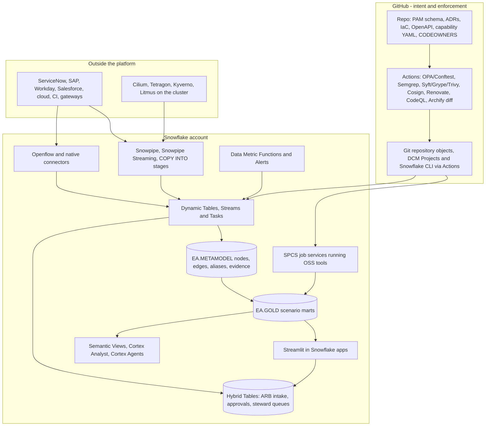

# 8.3 — Snowflake-hosted reference solution (C1–C15, S01–S20)

**Status:** solution v1 · **Date:** 2026-10-13 · **Scope:** one buildable solution that replaces Orbus Infinity across all fifteen canonical capabilities and runs all twenty scenarios, hosted on **Snowflake**, with **GitHub** carrying intent and enforcement.

Licensed components: **GitHub** and **Snowflake** only. Everything else is free/open-source and hosted inside Snowflake as a notebook, task, or SPCS service.

> **This is not the Databricks design with names swapped.** Snowflake is SQL-first, not Spark-first, and it has capabilities Databricks does not — zero-copy clone, Time Travel, Hybrid Tables, semantic views, and Horizon column lineage with Iceberg v3 row lineage. It is also weaker in three places (app hosting, ML training-to-serving lineage, and heavy Spark graph work). §7 and §8 are the honest comparison; the rest of the design exploits what Snowflake is actually good at.

---

## 1. Solution in one picture

---

## 2. Snowflake object layout

| Object | Type | Purpose |
|---|---|---|
| `EA.METAMODEL.NODES`, `.EDGES`, `.ALIASES`, `.EVIDENCE` | Tables (`VARIANT` for attributes) | The open CoreEA equivalent. Edges use the closed ArchiMate-aligned relation enum; aliases resolve CMDB sys_id, ARN, repo URL and billing tag to a URN; evidence carries source, confidence and pointer |
| `EA.METAMODEL.STANDARDS`, `.ADRS`, `.EXCEPTIONS` | Tables | Standards library, decision records, approved deviations (C2, C11) |
| `EA.BRONZE`, `EA.SILVER`, `EA.GOLD` | Schemas | Raw landed → conformed entities → one mart per scenario |
| `EA.OPS.ARB_INTAKE`, `.APPROVAL_QUEUE`, `.STEWARD_QUEUE` | **Hybrid Tables** | Row-level operational objects with primary keys and low-latency access — this is the operational plane, with no separate Postgres [@snowflake-hybrid-tables] |
| `EA.OPS.QUALITY`, `.FRESHNESS`, `.COVERAGE` | Tables + DMF results | The EA platform measured as a product [@snowflake-dmf] |
| `EA.LANDING` | Stage | SBOM JSON, contract PDFs, M&A discovery dumps |
| `EA.SEMANTIC.V_EA_PORTFOLIO`, `V_EA_FINOPS`, `V_EA_RISK` | **Semantic Views** | Governed metrics, relationships and synonyms that Cortex Analyst and Cortex Agents read [@snowflake-semantic-views] |
| `EA.APP.*` | Streamlit objects | The executive and steward surfaces |
| `EA.IMAGES` | Image repository | Archify, Syft/Grype/Trivy, ScanCode, Superset, Backstage, Evidence, Cloud Carbon Footprint |
| `EA_INGEST_WH`, `EA_TRANSFORM_WH`, `EA_QUERY_WH` | Warehouses | Separated by workload so cost is attributable |
| `EA_COMPUTE_POOL` | Compute pool | SPCS job services and long-running services |
| `EA_RESOURCE_MONITOR` | Resource monitor | Credit quota and alerting for the EA platform itself |

**Where the metamodel should be Iceberg:** keep `NODES` and `EDGES` as native tables for the operational path, and publish a governed copy as **Iceberg v3** tables through Horizon so external engines (Spark, Trino) can read the same graph and **row lineage** gives per-row provenance on every fact [@snowflake-iceberg-v3]. Native tables keep the fast path; Iceberg keeps the open path.

---

## 3. How each Orbus capability is delivered

All fifteen capabilities are covered, using Snowflake-native objects.

| C# | Orbus capability | Snowflake delivery | Free/OSS component and where it runs |
|---|---|---|---|
| **C1** | Governed architecture repository | `EA.METAMODEL` tables + **Time Travel** for history + **Git repository objects** for intent [@snowflake-git-integration] | Git, JSON Schema |
| **C2** | Metamodel & standards management | Schema validated by a Task on every change; `STANDARDS`; governed tags; closed relation enum enforced by a check routine | pyshacl, Pydantic in a Notebook |
| **C3** | Business capability & strategy mapping | Openflow/native connectors (Workday, SAP) joined to capability YAML → `GOLD.CAPABILITY_ROI` [@snowflake-openflow] | dbt Core in a Notebook |
| **C4** | Application portfolio management | ServiceNow connector [@snowflake-servicenow-connector] + Snowpipe on cost feeds → `GOLD.TIME_DISPOSITION`, `GOLD.UNIT_COST` [@snowflake-snowpipe] | — |
| **C5** | Technology portfolio & standards | `GOLD.TECHNOLOGY_LIFECYCLE` fed by an **SPCS job** running Syft/Trivy and calling endoflife.date through an External Access Integration; Renovate opens upgrades | Syft, Grype, Trivy (SPCS job) |
| **C6** | Data architecture & lineage views | **Horizon column-level lineage + Access History + object dependencies** → `GOLD.PII_LINEAGE`, `GOLD.GOLDEN_RECORDS` [@snowflake-horizon-catalog] | Presidio (Notebook), OpenLineage |
| **C7** | Process & value-stream modeling | Event and OpenTelemetry ingest → PM4Py in a **Snowflake Notebook** → `GOLD.PROCESS_LATENCY` | PM4Py |
| **C8** | Integration / interface catalog | Snowpipe Streaming on gateway logs + OpenAPI specs from a Git repository object → `GOLD.API_CATALOG` | Semgrep, OpenAPI tooling |
| **C9** | Diagramming & viewpoint publishing | **Task → `EXECUTE JOB SERVICE`** runs Archify and writes HTML/SVG to `EA.LANDING`; a Streamlit app renders it with URN deep links [@snowflake-execute-job-service] [@snowflake-spcs-job] | Archify (SPCS job) [@archify-github] |
| **C10** | Integrations & synchronization | **Openflow** connectors plus native connectors (ServiceNow, Salesforce, Workday, Google Analytics) plus Snowpipe/Streaming and `COPY INTO`; **Dynamic Tables** perform the reconciliation [@snowflake-dynamic-tables] | Steampipe/CloudQuery (SPCS job) |
| **C11** | ARB / governance workflows | GitHub PR gate; **Hybrid Table** intake and approval queue; Time Travel gives the immutable decision history | OPA/Conftest [@opa-conftest], CodeQL |
| **C12** | Reporting, audit & executive dashboards | **Semantic Views + Cortex Analyst + Cortex Agents**, Streamlit apps, Snowflake dashboards, Access History for audit [@snowflake-cortex-agents] [@snowflake-streamlit] | Superset (SPCS service) |
| **C13** | Collaboration & stakeholder access | Streamlit apps + Semantic Views + row access policies and tag-based masking; **Data Clean Rooms** and secure shares for M&A [@snowflake-clean-rooms] | Backstage (SPCS service) |
| **C14** | Security / risk architecture views | Flow logs and policy results → `GOLD.TRUST_ZONES`, `GOLD.DR_RTO_RPO`, `GOLD.EOL_RISK`, `GOLD.VENDOR_LOCKIN` | Cilium, Tetragon, Kyverno on the cluster [@cilium-tetragon] |
| **C15** | Roadmapping & transformation planning | Migration waves built from IaC plans and dependency graphs; **zero-copy clones** to test target state → `GOLD.MIGRATION_WAVES` | OpenTofu, Infracost (SPCS job) |

---

## 4. How each scenario runs

Capability IDs match [§3.1](01-licence-clean-ranked-options.md#31-orbus-anchor-by-scenario) and [baseline Table C](../01-baseline-orbus/06-baseline-tables.md). The **Snowflake-specific move** column is where this design differs from the Databricks one.

| Scenario | C# | Pipeline | Gold mart | Surface | Archify | Snowflake-specific move |
|---|---|---|---|---|---|---|
| S01 APM / TIME | C4, C12 | Dynamic Tables over CMDB + cost | `TIME_DISPOSITION` | Streamlit + Cortex Analyst | architecture | Cost scoring in a **Semantic View**, so the exec answer is a governed object, not a prompt |
| S02 EOL / EOS | C5, C11 | `TASK_EOL_SCAN` → SPCS job | `EOL_RISK` | Streamlit | lifecycle | SPCS runs Syft/Trivy; **Alert** on any critical finding |
| S03 Migration | C15, C9 | `TASK_MIGRATION_WAVES` | `MIGRATION_WAVES` | Streamlit | architecture + sequence | **Zero-copy clone** of the estate to rehearse the target state with no data copy |
| S04 Capabilities | C3, C12 | Openflow Workday/SAP + capability YAML | `CAPABILITY_ROI` | Cortex Analyst | architecture | Capability→cost exposed as a **Semantic View** for finance-grade answers |
| S05 ARB | C11, C2 | `TASK_ARB_GATE` | `ARB_DECISIONS` + **Hybrid Table** | Streamlit intake | workflow + architecture | Approval queue is a **Hybrid Table**; Time Travel is the audit ledger |
| S06 CMDB sync | C10, C1 | ServiceNow connector + Dynamic Tables | `CMDB_RECONCILED` | Streamlit | lifecycle | Reconciliation expressed as **DMFs** on drift, null owners and orphan CIs |
| S07 M&A | C1, C9 | `TASK_MA_DISCOVERY` + SPCS scan | `MA_INVENTORY` | Streamlit + Clean Room | architecture + dataflow | **Data Clean Rooms** plus a zero-copy clone of the fenced estate — no data movement |
| S08 Privacy | C6, C14 | `TASK_PRIVACY_LINEAGE` | `PII_LINEAGE` | Streamlit | dataflow | **Horizon lineage + Access History + Iceberg v3 row lineage** is the strongest audit artefact of any option |
| S09 Interfaces | C8, C9 | Snowpipe Streaming + Dynamic Tables | `API_CATALOG` | Streamlit | sequence + architecture | Zombie detection as SQL over declared-vs-actual, refreshed by target lag |
| S10 Process | C7, C3 | `TASK_PROCESS_MINING` | `PROCESS_LATENCY` | Streamlit | workflow | PM4Py in a **Notebook**; if Spark code exists, run it via **Snowpark Connect for Apache Spark** [@snowflake-snowpark-connect-spark] |
| S11 AI governance | C6, C11 | `TASK_AI_GOVERNANCE` | `MODEL_RISK` | Streamlit + Cortex Agents | architecture | **Model Registry** + Horizon tags; MLflow OSS in SPCS fills the training-chain gap |
| S12 DR | C14, C15 | `TASK_DR_SLA` | `DR_RTO_RPO` | Streamlit | lifecycle + architecture | **Account replication and failover groups** are the RTO/RPO source of truth |
| S13 Technical debt | C4, C12 | Git repository object + Notebook | `TECH_DEBT` | Streamlit | architecture | Churn vs complexity in Snowpark Python; no cluster |
| S14 Zero-trust | C14, C9 | Snowpipe Streaming + Dynamic Tables | `TRUST_ZONES` | Streamlit | architecture | IP-to-IP matrices as Dynamic Tables; policy results ingested from the cluster |
| S15 SBOM | C5, C11 | Snowpipe on `EA.LANDING` | `SBOM_RISK` | Streamlit | dataflow | SBOM JSON lands straight into **VARIANT**; Stream→Task blocks non-compliant packages |
| S16 FinOps | C4, C12 | Billing + `ACCOUNT_USAGE` | `UNIT_COST` | Streamlit + Cortex Analyst | architecture | EA cost is governed by a **resource monitor**, like any other workload |
| S17 MDM | C6 | Connectors + Dynamic Tables SCD2 | `GOLDEN_RECORDS` | Streamlit + **Cortex Search** | dataflow | Stewards query golden records in plain language via Cortex Search |
| S18 ESG carbon | C5, C12 | Snowpipe on carbon exports | `CARBON` | Streamlit | architecture | Utility invoices parsed with **Cortex Search** document handling |
| S19 Team topologies | C13, C4 | Git repository object + Notebook | `TEAM_COUPLING` | Streamlit | architecture + workflow | Co-change analysis in Snowpark Python over staged Git history |
| S20 Vendor exit | C5, C15 | `TASK_VENDOR_REVIEW` | `VENDOR_LOCKIN` | Streamlit | architecture | Contracts indexed with **Cortex Search**; Task alerts 90 days before renewal |

---

## 5. Orchestration inventory

**Ingestion** — Openflow connectors (Workday and the wider Openflow set) [@snowflake-openflow], native connectors (ServiceNow, Salesforce, Google Analytics), Snowpipe and Snowpipe Streaming for files, logs and events, `COPY INTO` from `EA.LANDING`, M&A discovery dumps from stages, telemetry from the Kubernetes cluster.

**Transforms** — **Dynamic Tables** for declarative, target-lag refreshes (the SQL-first analogue of a declarative pipeline) [@snowflake-dynamic-tables]; **Streams + Tasks** where an event-driven response is required rather than a lag-based refresh; **task graphs** for multi-step dependencies [@snowflake-tasks]; dbt Core or SQLMesh in a Notebook where SQL lineage and tests are wanted.

**Quality** — **Data Metric Functions** attached to silver and gold objects, with **Alerts** on breach [@snowflake-dmf]. These replace the expectations mechanism of a declarative pipeline framework.

**Containers** — a single reusable **`EXECUTE JOB SERVICE`** pattern for Archify, Syft/Grype/Trivy, ScanCode, OpenTofu and Infracost, invoked from Tasks with `ASYNC=true` so a long render cannot be cancelled by a statement timeout [@snowflake-spcs-limitations].

**Cost control** — separate warehouses per workload and a resource monitor with alerts; SPCS compute pools are tracked as their own line item.

---

## 6. Serving surfaces

| Surface | Type | Serves |
|---|---|---|
| `EA_PORTFOLIO_APP` | Streamlit in Snowflake | TIME, capability investment, process latency, team coupling (S01, S04, S10, S19) |
| `EA_ARCHITECTURE_STUDIO` | Streamlit in Snowflake | Archify artefacts rendered via `st.components.v1.html()`, API catalogue, vendor risk, migration waves (S06, S09, S03, S20) |
| `EA_ARB_APP` | Streamlit + **Hybrid Table** | ARB intake, policy results, approval audit (S05) |
| `EA_RISK_CONSOLE` | Streamlit | Privacy lineage, trust zones, DR RTO/RPO, carbon (S08, S14, S12, S18) |
| `EA_GOVERNANCE_APP` | Streamlit | EOL, tech debt, SBOM, AI model risk (S02, S13, S15, S11) |
| `EA_FINOPS_APP` | Streamlit | Unit cost and amortisation (S16) |
| `EA_STEWARD_APP` | Streamlit + Cortex Search | Golden-record curation and natural-language lookup (S17) |
| `EA.SEMANTIC.*` | Semantic Views | The governed metric layer every analyst and Cortex Analyst reads |
| `EA_ANALYST`, `EA_RECONCILER` | Cortex Agents | Natural-language answers and reconciliation proposals over gold marts [@snowflake-cortex-agents] |
| CoWork | Personal work agent | Ad-hoc executive questions across the same governed objects [@snowflake-cowork] |
| Optional OSS UIs | **SPCS services** | Superset, Backstage, Evidence, Cloud Carbon Footprint (all containerised — Streamlit-in-Snowflake is Streamlit-only and has package limits) |

### Backstage placement (optional, caveated)

Backstage fits Snowflake less comfortably than it fits Databricks, and the reason is its database. Backstage needs **PostgreSQL in production** (SQLite is development-only) [@backstage-postgres], and Snowflake provides no Postgres endpoint — Hybrid Tables are not Postgres-wire compatible. A licence-clean deployment therefore has three options:

| Option | How | Trade-off |
|---|---|---|
| **A. On the Kubernetes cluster** (recommended) | Backstage and its Postgres run on the cluster this solution already needs for Cilium, Tetragon, Kyverno and Litmus, fed one-way from PAM | Licence-clean and DR-able, but outside the platform |
| **B. Two containers in one SPCS service** | Backstage plus Postgres in a single service spec, image in `EA.IMAGES` | **SPCS objects cannot be replicated** [@snowflake-spcs-limitations], so portal state is not covered by DR |
| **C. Drop it** | Use the native Streamlit surfaces instead | Loses developer-facing portal ergonomics |

Option A is the only one that is both licence-clean and DR-sound. Options B and C are stated so the trade-off is explicit rather than hidden.

**Bounded role.** Backstage serves **C13 Collaboration & stakeholder access** strongly and **C1 Governed architecture repository** only partially. It receives entities one way through an entity provider [@backstage-entity-providers] and never authors PAM. The Snowflake-native Streamlit surfaces remain the executive tier.

---

## 7. Where this design beats the Databricks one

| Advantage | Why it matters | Scenarios |
|---|---|---|
| **Zero-copy clone** | Rehearse a migration or an acquisition against the real estate with no data duplication or cost of a copy | S03, S07 |
| **Time Travel** | Reconstruct the metamodel and the ARB ledger as of any past moment — a real audit capability, not a changelog | S01, S05, S08 |
| **Hybrid Tables (Unistore)** | Operational intake, approval and stewardship queues live in the same platform as the analytics — no separate Postgres service to run | S05, S17 |
| **Semantic Views** | The executive answer layer is a versioned, CI-reviewed SQL object, not a prompt configuration | S01, S04, S16 |
| **Horizon lineage + Access History + Iceberg v3 row lineage** | Column lineage, who-saw-what, and per-row provenance — the strongest regulator-facing package available here | S08, S17 |
| **Data Clean Rooms** | Legally fenced joint analysis with a counterparty without exposing either estate | S07, S20 |
| **DMFs** | Quality gates are native objects with alerting, not pipeline code | S06, S15, S17 |
| **Cortex Search** | Plain-language retrieval over contracts, invoices and standards with no extra vector database | S17, S18, S20 |
| **One engine, SQL-first** | Far less operational surface than Spark clusters; warehouses auto-suspend | All |

---

## 8. Where this design is weaker, and the compensation

| Weakness | Consequence | Compensation in this design |
|---|---|---|
| **Apps are Streamlit-only natively** | Superset, Backstage, Evidence, Cloud Carbon Footprint must run as **SPCS services** — container images, compute pools and ingress to manage, where Databricks Apps accepts Python or Node directly | Keep the executive tier in Streamlit; treat the OSS UIs as optional SPCS services rather than the primary surface |
| **ML training-to-serving lineage is thinner** | There is no native MLflow equivalent for S11 | Snowflake **Model Registry** + Horizon tags + OpenLineage, with MLflow OSS in SPCS if a full run-level chain is mandated |
| **Heavy graph and process mining is SQL-first** | Fuzzy entity resolution (S06) and large-scale process mining (S10) are less natural than Spark | **Snowpark Python** for matching, and **Snowpark Connect for Apache Spark** where existing Spark code must be reused |
| **No `%sh` shell in notebooks** | Go and JVM CLIs cannot be run as a quick shell step | Every such tool becomes an **SPCS job service**, which is cleaner and more auditable anyway — but it is more setup |
| **Dynamic Tables refresh on target lag, not events** | An event-driven response (block this SBOM, alert on this flow) is not what they do | Pair them with **Streams + Tasks** wherever the trigger matters |
| **DCM Projects are in public preview** | The declarative deploy path is less settled than a GA bundle format | Default to **Snowflake CLI + GitHub Actions** in production, and adopt DCM Projects when it leaves preview [@snowflake-dcm-projects] |
| **DMF quota** | Account-level limits apply to metric counts | Attach DMFs to the objects that matter (metamodel, silver, the gold marts), not every table |

---

## 9. The GitHub side

Identical in role to §7 of the Databricks chapter, with a different deploy mechanism.

| GitHub asset | Role |
|---|---|
| `ea-architecture` repo | PAM JSON Schema and Pydantic models, capability YAML, ADRs, standards, CODEOWNERS |
| Actions gates | OPA/Conftest, Semgrep, Gitleaks, Checkov, Syft/Grype/Trivy, Cosign, CodeQL |
| Renovate | Opens EOL and dependency upgrade PRs (S02) |
| Archify diff | Renders the architecture delta into the pull request (S05) |
| Deploy | **Snowflake CLI in GitHub Actions** (default) and **DCM Projects** once generally available; `CREATE GIT REPOSITORY` objects keep SQL and Python definition files in sync [@snowflake-git-integration] |

---

## 10. What must live outside Snowflake

The kernel and cluster layer only: **Cilium, Tetragon, Kyverno and Litmus** run on a Kubernetes cluster and export flow logs, policy results and game-day outcomes for S14 and S12. Source systems — ServiceNow, SAP, Workday, Salesforce, cloud accounts, CI and gateways — are external by definition.

Not required: **Kafka, Flink, Neo4j, Trino or PostgreSQL.** Snowpipe Streaming covers log and event ingest, Dynamic Tables and Streams cover the graph-adjacent SQL work, Hybrid Tables cover the operational need, and Horizon's Iceberg REST catalogue gives external engines access without a separate store.

---

## 11. Delivery and phasing

| Weeks | Work | Exit criteria |
|---|---|---|
| 1–2 | Database and schema layout, `EA.METAMODEL`, Hybrid Table queues, Git repo, CI gates, Snowflake CLI deploy path | Schema merged; sample graph loaded; gates green |
| 3–4 | `TASK_ARB_GATE`, `EA_ARB_APP`, `TASK_EOL_SCAN`, SBOM task and Stream | Five designs through PR-based ARB; EOL and SBOM alerts firing |
| 5–6 | ServiceNow connector and cost ingest, `TIME_DISPOSITION`, first Semantic View, `EA_PORTFOLIO_APP`, `EA_FINOPS_APP` | TIME and unit-cost dashboards live for executives |
| 7–8 | `CMDB_RECONCILED` with DMFs, `TECH_DEBT`, `TEAM_COUPLING`, `VENDOR_LOCKIN` | Reconciliation SLO met; drift DMFs alerting |
| 9–10 | `PII_LINEAGE` (Horizon + Iceberg v3), `GOLDEN_RECORDS`, `API_CATALOG`, `EA_STEWARD_APP` | One domain PII dataflow artefact accepted by audit; zombie API list published |
| 11–12 | S03 with a zero-copy clone rehearsal, S12 failover evidence, S14, S18, S10, S11, S07 plus executive readout | All twenty scenarios running; retire-Orbus go/no-go |

---

## 12. Verification

| Check | Status |
|---|---|
| All fifteen capabilities (C1–C15) covered | PASS |
| All twenty scenarios (S01–S20) implemented | PASS |
| Licence constraint honoured (GitHub and Snowflake only; all else OSS) | PASS |
| Every OSS component hosted in-platform per §5 of 8.1 | PASS |
| Scenario capability IDs match baseline Table C | PASS |
| Archify types limited to the five supported | PASS |
| Snowflake-specific advantages exploited, not ignored | PASS |
| Known Snowflake weaknesses stated with compensation | PASS |
| Backstage placement specified with DR caveat (cluster preferred) | PASS |
| Components that must stay outside identified (kernel layer only) | PASS |
| Citations present | PASS |

**Validation status:** PASS.  
**Confidence overall:** medium — Snowflake ships quickly and some features cited here are recent; re-verify against primary docs before implementation.

## Citations

[@snowflake-openflow] [@snowflake-hybrid-tables] [@snowflake-semantic-views] [@snowflake-dcm-projects] [@snowflake-git-integration] [@snowflake-dmf] [@snowflake-iceberg-v3] [@snowflake-clean-rooms] [@snowflake-cortex-search] [@snowflake-servicenow-connector] [@snowflake-snowpipe] [@snowflake-dynamic-tables] [@snowflake-tasks] [@snowflake-horizon-catalog] [@snowflake-cortex-agents] [@snowflake-cowork] [@snowflake-streamlit] [@snowflake-model-registry] [@snowflake-execute-job-service] [@snowflake-spcs-job] [@snowflake-spcs-limitations] [@snowflake-notebook-container-runtime] [@snowflake-snowpark-connect-spark] [@snowflake-vector-type] [@archify-github] [@opa-conftest] [@cilium-tetragon] [@syft] [@pm4py] [@backstage-postgres] [@backstage-entity-providers]
