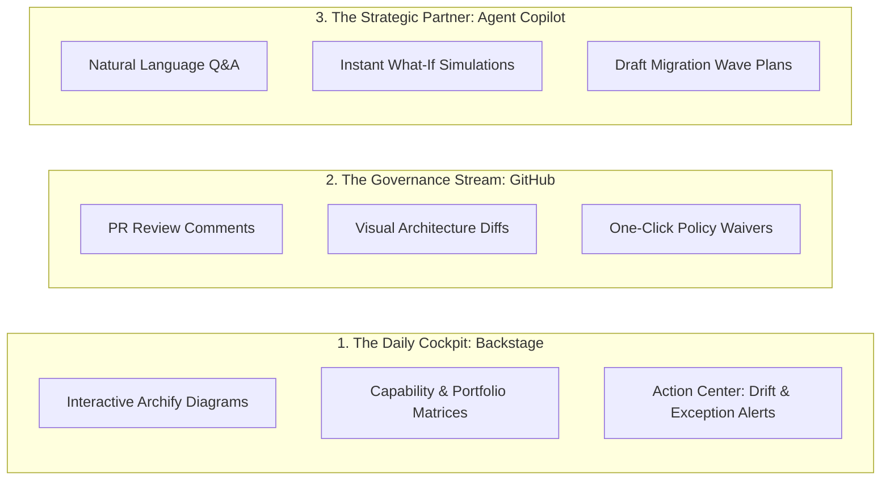

# 9.1 — The Agentic EA — Solution Ideation (Evo 1)

**Status:** draft v1 · **Date:** 2026-10-14 · **Scope:** User perspective, operating experience, and day-to-day workflow for the Enterprise Architect.

From the Enterprise Architect’s (EA) perspective, this solution is not five separate tools stitched together. It is an **intelligent cockpit and an AI staff**. 

The EA stops being a **data-entry clerk** chasing people for updates. Instead, the EA becomes an **Editor-in-Chief and Strategic Director**:
- The **AI Agents** do the research, drafting, scanning, and preliminary reviews.
- The **EA** provides judgment, approves exceptions, and sets policy.

---

## The 3 Core Touchpoints for the EA

The EA interacts with the system through three natural surfaces depending on what they are doing:

---

## 1. The Daily Cockpit (Backstage)
*Where the EA browses the estate, checks health, and sees living architecture.*

When the EA logs in to Backstage in the morning, they don't see an empty drawing canvas. They see a living catalog populated and kept fresh by the agents:

*   **Interactive Architecture Maps (Powered by Archify):**
    *   The EA clicks on any business capability (e.g., *"Customer Billing"*).
    *   An interactive Archify diagram renders instantly showing the microservices, databases, cloud resources, and external APIs supporting it.
    *   Clicking any box pulls live telemetry from Databricks: monthly cost, latency, PII data flags, owner, and EOL status.
*   **The Portfolio & TIME Matrix:**
    *   A live dashboard plotting every application on the TIME quadrant (Tolerate, Invest, Migrate, Eliminate).
    *   It is calculated automatically: Technical Debt (code complexity + EOL libraries) vs. Business Value (usage logs + capability criticality).
*   **The EA Action Center (The Inbox):**
    *   Instead of reading 50 status reports, the EA has a triaged queue of agent-detected anomalies:
        *   *“New undocumented RDS instance discovered in AWS us-east-1.”*
        *   *“API Gateway route `/v2/pay` has seen zero traffic for 90 days (Zombie API).”*
        *   *“Node.js 16 reaches EOL in 30 days across 4 payment services.”*
    *   Each alert has a one-click button: **[Approve Auto-Generated Fix PR]** or **[Dismiss]**.

---

## 2. The Zero-Meeting Governance Stream (GitHub)
*Where the EA governs changes without sitting in 2-hour ARB meetings.*

When a software team wants to introduce a new technology, deploy a service, or change database schemas, the EA doesn't ask them to submit a Word template. The team simply opens a standard Pull Request in GitHub.

**What the EA experiences:**
1. **The PR Notification:** The EA gets tagged on a PR only if high risk or unapproved tech is detected.
2. **The Agent's Pre-Review:** Under the PR, the **ARB Reviewer Agent** has already posted a clean summary:
   * **Visual Diff (Archify):** Shows a green/red diagram of the architecture *before* and *after* this PR.
   * **Standards Check:** *"PASSED: Uses standard company PostgreSQL and approved Docker base."*
   * **Cost Impact:** *"ALERT: Increases AWS egress by ~$1,200/month due to cross-region database queries."*
   * **Security Check:** *"WARNING: Service writes to a bucket containing unencrypted PII."*
3. **The EA Action:** The EA reviews the agent's findings, adds a quick comment or hits **Approve**. What used to take a 2-week ARB review cycle takes **3 minutes asynchronously**.

---

## 3. The Strategic Partner (Agent Copilot / Conversational Terminal)
*Where the EA answers hard executive questions in seconds.*

Available right inside Backstage, Slack/Teams, or the Databricks workspace, the EA has an on-demand AI partner that has indexed the entire enterprise graph in Databricks.

**Sample EA Interactions:**

> **EA:** *"The CIO wants to know: what breaks if we decommission our legacy Oracle ERP by Q4, and what is our total saving?"*  
>   
> **Agent Copilot:**  
> 1. Queries the dependency graph in Databricks Unity Catalog.  
> 2. Identifies 14 downstream services, 3 nightly batch jobs, and 2 external partners directly tied to Oracle ERP.  
> 3. Pulls the cloud and license ledger: *$185,000/month recurring cost*.  
> 4. Renders an interactive Archify blast-radius diagram.  
> 5. Replies with a structured **3-Phase Cutover Plan** highlighting the two highest-risk integrations (Payroll and Order Fulfillment).

> **EA:** *"Draft an Architecture Decision Record (ADR) for moving our customer event stream to Apache Kafka, aligning with our Zero-Trust and GDPR standards."*  
>   
> **Agent Copilot:**  
> Generates a complete, standards-compliant ADR in markdown, links the relevant PAM entities, cites company security rules, and opens a draft PR in the `ea-architecture` repo ready for the EA to polish.

---

## A Day in the Life: Before vs. After

| Routine Task | The Orbus Infinity Reality | The Agentic EA Reality |
|---|---|---|
| **Inventory Update** | EA sends emails asking: *"Is service X still running on Postgres?"* Waits 3 weeks. | **Cartographer Agent** reads IaC and cloud APIs; estate updates itself in real time. |
| **ARB Review** | Bi-weekly 2-hour committee meeting with PowerPoint decks. Teams bypass it. | **Asynchronous PR Gate**: Agent checks standards, posts visual diff; EA approves in Git. |
| **Audit Preparation (DORA/GDPR)** | 2-month panic gathering spreadsheets to prove data lineage. | EA clicks **Export PII Lineage** in Backstage; Databricks verifies row/column truth instantly. |
| **EOL Library Patching** | EA manually tracks spreadsheets of Java/Python versions. | **Agent** automatically cuts a PR to the app repo upgrading the package and tagging the team. |
| **Executive "What-If" Analysis** | 5 days of manual Visio tracing and cost estimation. | **Agent Copilot** simulates blast radius and cost delta in 60 seconds. |

---

## How Other Roles Experience This System

- **Software Engineers:** They never log into an "EA Tool." They work in GitHub and Backstage. Architecture guidance appears natively in their PRs as helpful code suggestions and visual diffs.
- **CIO & Leadership:** They get live, executive-grade AI/BI dashboards in Databricks and can query the estate in plain language via Databricks Genie (*"What are our top 5 tech debt risks this quarter?"*).
- **Enterprise Architects:** They become high-leverage strategic partners who set the guardrails, direct the AI workforce, and focus on business innovation instead of clerical maintenance.
