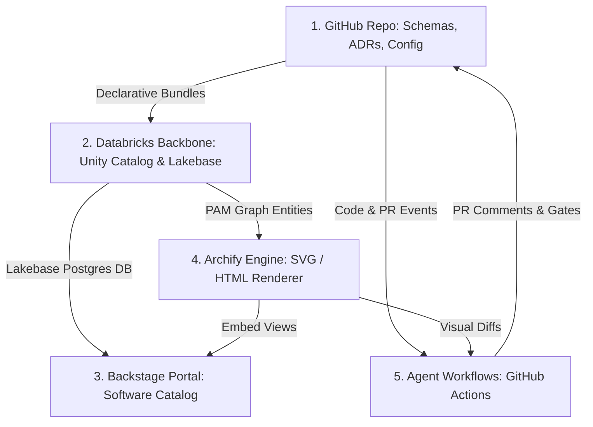

# 9.2 — How an Agent Builds the Solution

**Status:** draft v1 · **Date:** 2026-10-14 · **Scope:** Concrete engineering breakdown of how an autonomous agent assembles, provisions, wires, and verifies the Agentic EA platform.

To build this solution cleanly, an agent does not need fuzzy AI metaphors. It treats the build as **constructing four concrete subsystems and wiring their inputs and outputs into a closed loop**.

---

## The Build Topology: What the Agent Actually Assembles

The agent's objective is to assemble four concrete layers and an automation harness:

---

## 1. Scaffolding the Core Repo & Metamodel Contract (GitHub)
*The agent begins by creating the foundational repository and data schemas that everything else relies on.*

*   **Repository Structure:** Creates the central `ea-platform` repository containing directories for schemas, Backstage configuration, Databricks bundle declarations, and CI workflows.
*   **The Data Contract (PAM Schemas):** Writes the JSON Schemas / Pydantic definitions for the Platform Architecture Metamodel:
    *   `nodes.schema.json`: System entities (Applications, Capabilities, Services, Databases, Cloud Resources).
    *   `edges.schema.json`: ArchiMate-aligned relationships (`serves`, `accesses`, `flows_to`, `deploys_to`).
    *   `evidence.schema.json`: Source tracking (confidence score, source system, timestamp).
*   **Policy Rules:** Writes initial declarative policy files (e.g., OPA/Conftest rules) for baseline checks: approved base Docker images, allowed cloud regions, and mandatory ownership tags.

---

## 2. Provisioning the Data & Analytical Backbone (Databricks)
*The agent uses Databricks declarative configuration to build the analytical storage and the operational database.*

*   **Declarative Infrastructure:** Generates a **Databricks Asset Bundle (DAB)** to deploy resources without manual console clicks:
    *   **Unity Catalog Schemas:** Sets up `ea.metamodel` (graph tables), `ea.bronze` (raw feeds), `ea.silver` (conformed entities), and `ea.gold` (scenario-specific marts like `time_disposition`, `eol_risk`, `pii_lineage`).
    *   **Operational Database (Lakebase):** Configures a managed PostgreSQL instance in Databricks to serve as the storage backend for Backstage and the ARB approval ledger.
*   **Ingestion & Pipelines:** Generates declarative pipelines (Spark Declarative Pipelines / Delta Live Tables) that ingest:
    *   ServiceNow CMDB exports.
    *   Cloud cost and billing exports (CUR).
    *   Git repository metadata and OpenAPI files.

---

## 3. Assembling the Developer & Architecture Portal (Backstage)
*The agent builds a working Backstage app and connects it to the Databricks backbone.*

*   **App Initialization:** Scaffolds a standard Node.js Backstage application.
*   **Database Wiring:** Configures `app-config.yaml` so Backstage uses the Databricks **Lakebase PostgreSQL** instance created in Step 2.
*   **Catalog Entity Provider:** Writes a lightweight Backstage Entity Provider that reads entities from Databricks `ea.metamodel.nodes` and syncs them into the Backstage software catalog.
*   **Plugin Setup:** Enables core plugins for APIs, TechDocs, system relationships, and ownership scorecards.

---

## 4. Integrating the Visualizer (Archify)
*The agent sets up Archify to generate visual diagrams on demand.*

*   **The Conversion Bridge:** Writes a small transformation utility that queries the graph tables in Databricks and outputs typed Archify JSON format (`architecture`, `workflow`, `sequence`, `dataflow`, `lifecycle`).
*   **Packaging:** Bundles the Archify CLI runner into a reusable container task so it can be invoked by both Databricks jobs and GitHub Actions.
*   **Embedding:**
    *   Wires Backstage component pages to load the generated Archify SVGs directly inside the service views.
    *   Wires the CI runner to output visual image diffs onto GitHub Pull Requests.

---

## 5. Writing the Agentic Automation Harness (The Active Loop)
*The agent creates the scripts and GitHub Actions workflows that perform the day-to-day EA tasks.*

*   **The Cartographer Job (Discovery):**
    *   A scheduled workflow that clones organization repos, inspects package manifests (`package.json`, `pom.xml`, `requirements.txt`), Dockerfiles, and Terraform definitions.
    *   Extracts components and pushes them into the Databricks landing area to keep the catalog fresh.
*   **The ARB PR Gate (Governance):**
    *   A GitHub Action triggered whenever a PR touches infrastructure or architecture files.
    *   The workflow invokes an LLM agent with access to:
        1. The PR diff.
        2. The corporate standards library.
        3. Archify CLI.
    *   The agent generates an evaluation comment on the PR containing: standards compliance, cost estimate, and an Archify before/after visual diff.
*   **The Drift Detector (Reconciliation):**
    *   A Databricks scheduled job that queries the `gold.cmdb_reconciled` table.
    *   If discrepancies between declared Git architecture and live cloud state exceed a threshold, it automatically creates a GitHub issue with the detected drift and proposed fix.

---

## How the Agent Verifies the Entire Build Works
*Before declaring the task complete, the agent runs a closed-loop integration verification:*

1. **Seed Data:** Ingests sample data for two microservices, a database, and an API spec into Git.
2. **Pipeline Run:** Triggers the Databricks pipeline to confirm data flows from Bronze to Gold and populates `ea.metamodel`.
3. **Portal Verification:** Starts the Backstage container and verifies the services appear in the catalog with correct dependencies.
4. **Visualizer Check:** Executes Archify against the test graph to confirm a valid SVG diagram is rendered.
5. **Simulated PR:** Opens a synthetic PR adding an unapproved database; verifies that the ARB Action triggers, evaluates the policy, renders the visual diff, and blocks the merge.
