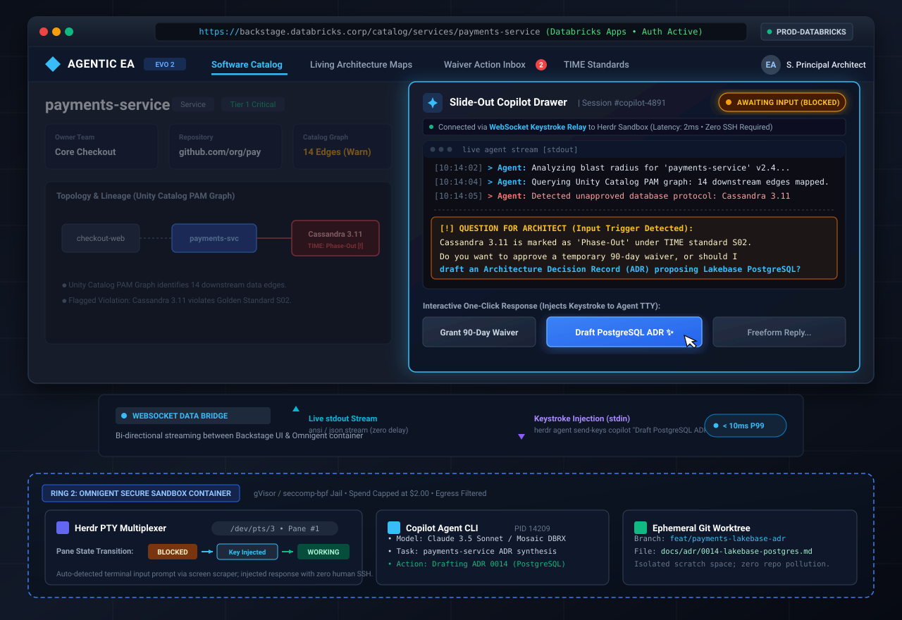

# 10.3 Collaborative Co-Driving in Backstage

One of the biggest frustrations with first-generation AI bots is that they are **unreachable**. They run in the dark, post a static comment on a pull request or ticket, and disappear. If the developer disagrees or if the architect wants to ask a follow-up question, they cannot respond directly—they have to schedule a meeting with a human committee.

**Evo 2** introduces **Collaborative Co-Driving**: a real-time bridge that connects the human Enterprise Architect in **Backstage** directly to the running agent in its terminal sandbox.

---

## 1. The Interaction Model: No Terminal Required

Enterprise Architects and engineering leads should never have to open an SSH terminal or manage background daemon processes. Instead, the interaction takes place through the **Backstage Copilot Drawer**, hosted natively in Databricks Apps:



> **Interactive Architecture Diagram (Archify Showcase):** The system architecture and real-time streaming bridge is compiled as an interactive explorable diagram at [`assets/diagrams/collaborative-codriving-architecture.html`](../../assets/diagrams/collaborative-codriving-architecture.html) with standalone vector graphic at [`assets/diagrams/collaborative-codriving-architecture.svg`](../../assets/diagrams/collaborative-codriving-architecture.svg) and specification at [`assets/diagrams/collaborative-codriving-architecture.json`](../../assets/diagrams/collaborative-codriving-architecture.json).

<details>
<summary>Click to view ASCII interaction schematic</summary>

```text
┌─────────────────────────────────────────────────────────────────────────────┐
│ BACKSTAGE OPERATING COCKPIT (Browser / Databricks Apps)                     │
│                                                                             │
│  [ Software Catalog ]  [ Living Architecture Maps ]  [ Waiver Action Inbox ]│
│                                                                             │
│  ┌───────────────────────────────────────────────────────────────────────┐  │
│  │ SLIDE-OUT COPILOT DRAWER                                              │  │
│  │                                                                       │  │
│  │  Live Session Stream (Connected to Agent via WebSocket)               │  │
│  │  ┌─────────────────────────────────────────────────────────────────┐  │  │
│  │  │ > Agent: Analyzing blast radius for 'payments-service' v2.4...  │  │  │
│  │  │ > Agent: Querying Unity Catalog PAM graph: 14 downstream edges. │  │  │
│  │  │ > Agent: Detected unapproved database protocol: Cassandra 3.11  │  │  │
│  │  │                                                                 │  │  │
│  │  │ [!] QUESTION FOR ARCHITECT:                                     │  │  │
│  │  │ Cassandra is marked as 'Phase-Out' under TIME standard S02.     │  │  │
│  │  │ Do you want to approve a temporary 90-day waiver, or should I   │  │  │
│  │  │ draft an ADR proposing a migration to Lakebase PostgreSQL?      │  │  │
│  │  └─────────────────────────────────────────────────────────────────┘  │  │
│  │                                                                       │  │
│  │  Interactive Action Buttons (One-Click Response):                     │  │
│  │  [ Grant 90-Day Waiver ]  [ Draft PostgreSQL ADR ]  [ Freeform Reply ] │  │
│  └───────────────────────────────────────────────────────────────────────┘  │
└──────────────────────────────────────┬──────────────────────────────────────┘
                                       │ WebSocket Keystroke Relay
┌──────────────────────────────────────▼──────────────────────────────────────┐
│ HERDR PTY MULTIPLEXER (Running inside Omnigent Sandbox)                      │
│   • Pane Status: BLOCKED ──► Injects Keystroke ──► Transitions to WORKING    │
└─────────────────────────────────────────────────────────────────────────────┘
```

</details>

---

## 2. The Two Core Technical Breakthroughs

### Breakthrough 1: The "Blocked State" Bridge
When an agent encounters a strategic decision point or an unapproved technology, it should not blindly guess or halt execution with an error. Instead, it stops and prompts the user.

1. **Detection in the Terminal:** Herdr continuously monitors the bottom of the agent's terminal screen. When it detects an input prompt or question dialog, it marks the agent's lifecycle state as **`blocked`**.
2. **Translation to the Web:** Omnigent receives the state change and converts the terminal prompt into a clean, structured UI card in the Backstage Copilot Drawer (and optionally in a GitHub PR comment).
3. **Keystroke Injection:** When the architect clicks a button (e.g., `Draft PostgreSQL ADR`), Omnigent tells Herdr to send that specific answer back into the agent's running terminal pane:
   ```bash
   herdr agent send-keys copilot "Draft PostgreSQL ADR"
   ```
4. **Resumption:** Herdr detects the agent has resumed computation and transitions the state back to **`working`**. The architect watches the agent resume in real time without ever touching a command prompt.

### Breakthrough 2: Live WebSocket Streaming with Zero Lag
- Traditional web hooks only provide updates *after* an agent finishes a job.
- Omnigent provides a lightweight streaming endpoint that pipes the agent's terminal output directly to the Backstage UI over a WebSocket connection.
- Soft line wraps, colors, and progress spinners are cleanly rendered in the browser. The architect can see the agent's thought process, which database tables it queries, and how it formulates recommendations.

---

## 3. End-to-End Walkthrough: Co-Authoring an Architecture Decision Record (ADR)

Here is how an Enterprise Architect uses Co-Driving to resolve an architecture conflict in under three minutes:

| Step | Human Action (In Backstage) | Agent Action (In Herdr / Omnigent) | Platform State |
| :--- | :--- | :--- | :--- |
| **1. Trigger** | Architect clicks *"Evaluate Payment Service Migration"* in Backstage. | Omnigent starts a sandboxed Copilot agent in Herdr; WebSocket connection opens. | Agent state: `working`. |
| **2. Analysis** | Architect watches live terminal feed in the slide-out drawer. | Agent executes SQL queries against Unity Catalog PAM Delta tables to map dependencies. | 14 dependencies discovered; 1 legacy database flagged. |
| **3. Question** | Architect sees an interactive card: *"Cassandra is deprecated. Propose replacement?"* | Herdr detects interactive question prompt; sets state to `blocked`. | Execution paused safely. |
| **4. Steer** | Architect clicks **[Propose Lakebase PostgreSQL]**. | Omnigent sends `"Lakebase PostgreSQL"` into the Herdr pane; state switches to `working`. | Agent resumes immediately. |
| **5. Synthesis**| Architect reviews the generated ADR text and preview diagram. | Agent drafts `ADR-0142-payments-postgres.md` and calls Archify to render the target-state architecture SVG. | Metamodel delta JSON compiled. |
| **6. Commit** | Architect clicks **[Approve & Open PR]**. | Agent commits the ADR to the architecture repository and records the decision in Unity Catalog. | Audit trail permanently logged. |

---

## 4. Why This Eliminates Architecture Governance Friction

1. **Zero Context-Switching:** The architect stays in Backstage; the developer stays in GitHub. Neither role has to switch tools or learn complex CLI syntax.
2. **No Deadlocks:** When an agent gets stuck or needs human judgment, it asks directly instead of failing silently.
3. **Full Auditability:** Every question asked by the agent and every button clicked by the human is automatically recorded in the Databricks Lakehouse audit log, creating an immutable compliance trail for regulatory frameworks like DORA and GDPR.
